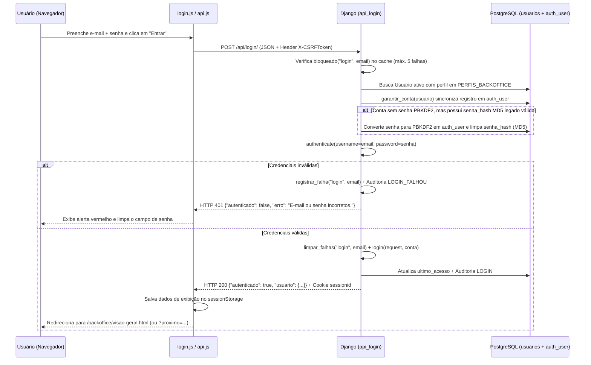

# Documentação Técnica — Autenticação, Sessão e Recuperação de Senha (SupplyFlow)

Este documento descreve de ponta a ponta como funcionam os mecanismos de **login do Backoffice**, **criação e recuperação de senha por e-mail**, **controle de sessão e permissões (RBAC)** e **autenticação rápida no Totem de Autoatendimento**, além de apresentar uma auditoria técnica do código atual e suas fragilidades conhecidas.

---

## 1. Visão Geral da Arquitetura

O **SupplyFlow** possui dois contextos distintos de autenticação que operam sobre a mesma base de colaboradores (`tabela usuarios`), mas com credenciais e regras de sessão separadas:

| Contexto | Público-Alvo | Credencial | Algoritmo de Hash | Tempo de Sessão |
| :--- | :--- | :--- | :--- | :--- |
| **Backoffice Administrativo** (`/`) | `ADMIN`, `GESTOR`, `TECNICO_SEGURANCA`, `OPERADOR`, `COMPRADOR` | E-mail + Senha pessoal | **PBKDF2-SHA256** (`auth_user` do Django) | 8 horas (ou ao fechar o navegador) |
| **Totem de Autoatendimento** (`/totem/`) | Todos os colaboradores ativos (`COLABORADOR` e demais) | Matrícula + PIN numérico | **PBKDF2-SHA256** (`usuarios.pin_hash`) | 10 minutos de inatividade |

---

## 2. Mapa de Arquivos do Módulo de Login

### Frontend (HTML + JavaScript)
- **[`index.html`](../index.html)**: Tela de login do Backoffice. Contém o formulário de e-mail e senha (`#form-login`), alerta de erro acessível (`#login-erro`), atalho para `/senha/esqueci/` e link para o Totem (`/totem/`).
- **[`static/js/login.js`](../static/js/login.js)**: Controla o envio assíncrono do formulário para `POST /api/login/`, exibe erros de credenciais, grava os dados visuais do usuário em `SF.sessao` e redireciona de forma segura (`destinoSeguro()`).
- **[`static/js/sessao.js`](../static/js/sessao.js)**: Mantém no `sessionStorage` (`supplyflow.usuario`) uma cópia não-sensível dos dados do usuário logado (`nome`, `perfil`, `acoes`) apenas para montagem rápida do menu e topo, além de expor `SF.sessao.confirmar()`, `SF.sessao.pode(acao)` e `SF.sessao.encerrar()`.
- **[`static/js/api.js`](../static/js/api.js)**: Cliente HTTP centralizado (`SF.api.get` e `SF.api.post`). Lê automaticamente o cookie `csrftoken` e o envia no cabeçalho `X-CSRFToken`, além de interceptar respostas `HTTP 401` redirecionando para `/?proximo=<url_atual>`.

### Backend (Django)
- **[`core/models.py`](../core/models.py)**: Modelo `Usuario` (tabela `usuarios`) vinculado via `OneToOneField` opcional (`conta`) ao modelo de autenticação nativo do Django (`auth.User`).
- **[`core/views/autenticacao.py`](../core/views/autenticacao.py)**: Endpoints `api_login` (`POST /api/login/`), `api_logout` (`POST /api/logout/`), `api_sessao` (`GET /api/sessao/`) e a view `RedefinirSenhaView` (`/senha/nova/<uidb64>/<token>/`).
- **[`core/contas.py`](../core/contas.py)**: Sincronização entre `Usuario` e `auth.User` (`garantir_conta`), formulário customizado de recuperação (`FormularioRedefinicao`) e disparo de convite (`enviar_link_de_senha`).
- **[`core/seguranca.py`](../core/seguranca.py)**: Validação e hash de PINs (`definir_pin`, `verificar_pin`), verificação de hashes legados em MD5 (`senha_legada_confere`) e controle de bloqueio por tentativas (`bloqueado`, `registrar_falha`, `limpar_falhas`).
- **[`core/permissoes.py`](../core/permissoes.py)**: Matriz RBAC de perfis e ações (`ACOES`, `PERFIS_BACKOFFICE`) e decoradores `@pagina_backoffice(acao)` e `@api_backoffice(acao)`.
- **[`core/correio.py`](../core/correio.py)**: Backend de e-mail resiliente (`BackendEmailResiliente`) com suporte a API HTTPS (Brevo / Resend na porta 443), SMTP com timeout curto e fallback automático para os logs do servidor.

### Templates do Fluxo de Senha
- **[`templates/registration/esqueci-senha.html`](../templates/registration/esqueci-senha.html)**: Formulário para solicitar o link de redefinição (`GET/POST /senha/esqueci/`).
- **[`templates/registration/senha-enviada.html`](../templates/registration/senha-enviada.html)**: Confirmação de envio (`/senha/enviada/`).
- **[`templates/registration/nova-senha.html`](../templates/registration/nova-senha.html)**: Tela onde o usuário define e confirma a nova senha (`/senha/nova/<uidb64>/<token>/`).
- **[`templates/registration/senha-concluida.html`](../templates/registration/senha-concluida.html)**: Confirmação final com botão para voltar ao login (`/senha/concluida/`).

---

## 3. Como Funciona na Prática (Fluxos Passo a Passo)

### 3.1. Fluxo de Login no Backoffice (`POST /api/login/`)

1. **Validação de Entrada e Bloqueio Temporário:**
   - O endpoint normaliza o e-mail (`.strip().lower()`) e verifica se há bloqueio ativo (`bloqueado("login", email)`). Após **5 tentativas incorretas**, o e-mail fica bloqueado por **15 minutos**, retornando `HTTP 429`.
2. **Sincronização Automática de Conta (`garantir_conta`):**
   - Cada `Usuario` com perfil administrativo possui um `auth.User` espelhado no Django. Se o registro em `usuarios` veio do banco legado e ainda não tinha `auth.User`, `garantir_conta()` o cria automaticamente no momento do login ou da recuperação de senha.
3. **Migração Transparente de Hash Legado (MD5 $\rightarrow$ PBKDF2):**
   - Os dados iniciais do seed (`setup_banco.sql`) usavam `md5()` do PostgreSQL em `usuarios.senha_hash` e `usuarios.pin_hash`.
   - No primeiro login bem-sucedido, o sistema detecta o hash MD5 de 32 caracteres, valida-o com comparação em tempo constante (`hmac.compare_digest`), grava a senha com **PBKDF2-SHA256** na conta do Django e **apaga o MD5 antigo** (`usuario.senha_hash = None`).
4. **Prevenção contra Open Redirect:**
   - Após o login, `destinoSeguro()` em `static/js/login.js` valida o parâmetro `?proximo=` com a expressão regular `/^\/backoffice\/[a-z0-9-]+\.html(\?[^#]*)?$/i`, garantindo que o navegador nunca seja redirecionado para um domínio externo.

---

### 3.2. Primeiro Acesso e Recuperação de Senha ("Esqueci minha senha")

Por requisito de segurança e privacidade (**RF-08**), **o Administrador nunca define nem visualiza a senha de outro usuário do Backoffice**:

1. **No Cadastro de Funcionário (`POST /api/funcionarios/salvar/`):**
   - Quando o Administrador cadastra um funcionário com perfil de Backoffice (`ADMIN`, `GESTOR`, `OPERADOR`, etc.), a conta é criada com senha inutilizável (`set_unusable_password()`) e o servidor dispara automaticamente um e-mail com o link único para a própria pessoa criar sua senha.
   - Na tela de Usuários (`/backoffice/usuarios.html`), o Administrador também pode clicar em **"Enviar link de senha"** (`POST /api/funcionarios/<id>/enviar-link-senha/`).
2. **Na Tela "Esqueci minha senha" (`/senha/esqueci/`):**
   - O usuário informa seu e-mail.
   - `FormularioRedefinicao.get_users(email)` busca em `Usuario` todos os registros ativos com aquele e-mail que pertençam a `PERFIS_BACKOFFICE` e chama `garantir_conta(usuario)`.
   - O Django gera um token criptográfico assinado com validade de **1 hora** (`PASSWORD_RESET_TIMEOUT = 3600`) que **se invalida automaticamente assim que a senha é alterada**.
3. **Ao Salvar a Nova Senha (`RedefinirSenhaView`):**
   - O Django aplica os 4 validadores de força de senha (`MinimumLengthValidator` mín. 8 caracteres, `UserAttributeSimilarityValidator`, `CommonPasswordValidator`, `NumericPasswordValidator`).
   - E o validador próprio `core.validadores.SenhaDiferenteDaAtual`: a nova senha não pode ser igual à atual (inclusive a senha antiga em MD5 ainda não migrada). Não há histórico de senhas — a comparação é só com o hash atual. No convite de primeiro acesso (conta sem senha) a regra não se aplica.
   - Limpa qualquer `senha_hash` legado e grava o evento `SENHA_DEFINIDA` na trilha de auditoria.

---

### 3.3. Envio de E-mail Resiliente em Nuvem (`core/correio.py`)

Como plataformas PaaS gratuitas (como o **Render Free**) bloqueiam conexões de saída nas portas SMTP (`25`, `465` e `587`), o `BackendEmailResiliente` opera em cascata:

1. **Prioridade 1 — API HTTPS da Brevo (`BREVO_API_KEY`):**
   - Dispara `POST https://api.brevo.com/v3/smtp/email` via **porta 443 (HTTPS)** (liberada no Render Free).
2. **Prioridade 2 — API HTTPS do Resend (`RESEND_API_KEY`):**
   - Dispara `POST https://api.resend.com/emails` via **porta 443 (HTTPS)**.
3. **Prioridade 3 — SMTP Tradicional (`EMAIL_HOST`):**
   - Tenta conexão SMTP com timeout curto (`EMAIL_TIMEOUT = 5s`) para evitar travar o worker do Gunicorn.
4. **Prioridade 4 — Fallback Seguro no Log (`_imprimir_no_log`):**
   - Caso nenhuma chave esteja configurada ou ocorra qualquer erro de rede/API, o sistema captura a exceção (evitando erro `500` para o usuário) e imprime o link completo em **texto puro (sem quebra `quoted-printable`)** nos logs do servidor.

---

### 3.4. Controle de Sessão e Permissões por Perfil (RBAC)

A segurança não depende do JavaScript:
- **No Servidor (`core/permissoes.py`):**
  - Toda página HTML do Backoffice usa `@pagina_backoffice("acao")` (redireciona para `/?proximo=...` se não estiver autenticado ou renderiza `acesso-negado.html` com `HTTP 403` se o perfil não tiver a ação).
  - Toda rota JSON usa `@api_backoffice("acao")` (retorna `HTTP 401` sem sessão ou `HTTP 403` sem permissão).
- **Matriz de Permissões (`ACOES`):**

| Perfil | Código | Ações Liberadas no Servidor |
| :--- | :--- | :--- |
| **Administrador** | `ADMIN` | `ver`, `decidir`, `entregar`, `devolucao`, `estoque`, `produtos`, `pessoas`, `auditoria`, `ia` |
| **Gestor / Supervisor** | `GESTOR` | `ver`, `decidir`, `devolucao`, `ia` |
| **Técnico de Segurança** | `TECNICO_SEGURANCA` | `ver`, `decidir`, `devolucao`, `ia` |
| **Almoxarife** | `OPERADOR` | `ver`, `entregar`, `devolucao`, `estoque` |
| **Comprador** | `COMPRADOR` | `ver`, `estoque`, `produtos` |
| **Colaborador** | `COLABORADOR` | *(Nenhuma no Backoffice — acesso exclusivo ao Totem)* |

---

## 4. Como Está Configurado no Ambiente (`.env` e Render)

As variáveis de ambiente que controlam a segurança e a autenticação em [`config/settings.py`](../config/settings.py) são:

| Variável | Função | Valor Recomendado em Produção (Render) |
| :--- | :--- | :--- |
| `DEBUG` | Modo de depuração | `False` (desligado por padrão) |
| `SECRET_KEY` | Assinatura de sessões, CSRF e tokens de senha | String aleatória longa e secreta |
| `DATABASE_URL` | Conexão PostgreSQL | URL do banco no Render |
| `BREVO_API_KEY` | Chave da API HTTP da Brevo (`xkeysib-...`) | Configurada no painel Environment do Render |
| `DEFAULT_FROM_EMAIL` | Remetente verificado na Brevo | `SupplyFlow <thiagoanacletonn3@gmail.com>` |
| `SESSION_COOKIE_AGE` | Tempo máximo da sessão do Backoffice | `28800` (8 horas, fixo em `settings.py`) |
| `PASSWORD_RESET_TIMEOUT` | Validade do link de redefinição de senha | `3600` (1 hora, fixo em `settings.py`) |

### Requisitos da Conta Brevo para Funcionamento Contínuo
1. **Remetente Verificado:** O e-mail definido em `DEFAULT_FROM_EMAIL` (`thiagoanacletonn3@gmail.com`) deve estar com status **Ativo** em *Configurações $\rightarrow$ Remetentes, domínio, IPs $\rightarrow$ Remetentes*.
2. **Bloqueio de IP Desativado para API:** Em *Configurações $\rightarrow$ Segurança $\rightarrow$ IPs autorizados* (`https://app.brevo.com/security/authorised_ips`), a opção **"Bloquear endereços IP não autorizados"** para **Chaves API** deve permanecer **Desativada**, pois o Render utiliza IPs dinâmicos de nuvem.

---

## 5. Avaliação do Código: Fragilidades Identificadas e Recomendações

Após inspecionar todo o código de autenticação, sessão e recuperação de senha, o sistema mostra uma base sólida (uso de CSRF, cookies `HttpOnly` e `Secure` em produção, RBAC validado no servidor, proteção contra Open Redirect e migração de MD5 para PBKDF2). No entanto, existem **6 fragilidades técnicas** que merecem atenção:

### 1. Bloqueio de Tentativas (`Rate Limit`) baseado apenas no E-mail/Matrícula e em Memória Local (Severidade: Média)
- **Onde está:** [`core/seguranca.py`](../core/seguranca.py) (`bloqueado`, `registrar_falha`) e [`config/settings.py`](../config/settings.py).
- **Como funciona hoje:** Após 5 senhas erradas para o mesmo `email` (ou `matricula`), a chave `tentativas:login:<email>` é bloqueada por 15 minutos no cache padrão do Django (`LocMemCache`).
- **Fragilidades:**
  1. **Negação de Serviço (Account Lockout):** Como a chave usa apenas o e-mail (e não o par `email + IP`), qualquer pessoa que saiba o e-mail do administrador pode digitar 5 senhas erradas de propósito e impedir o administrador verdadeiro de entrar por 15 minutos.
  2. **Cache volátil:** Como `CACHES` não está configurado no `settings.py` para usar o banco de dados (`DatabaseCache`) ou Redis, o contador fica na memória RAM do processo Gunicorn — se o container reiniciar ou tiver mais de 1 worker, a contagem de tentativas se perde.
- **Como corrigir se necessário:** Incluir o IP de origem na chave de bloqueio e configurar `DatabaseCache` no PostgreSQL.

### 2. Divergência no Tamanho do PIN entre Backend (4 a 6 dígitos) e Totem Frontend (fixo em 4 dígitos) (Severidade: Média)
- **Onde está:** [`core/seguranca.py`](../core/seguranca.py) (linha 26: `r"\d{4,6}"`) vs. [`static/js/totem.js`](../static/js/totem.js) (disparo automático ao atingir 4 dígitos).
- **Fragilidade:** No cadastro de funcionários do Backoffice, o backend aceita cadastrar um PIN de **5 ou 6 dígitos**. Porém, na tela do Totem (`/totem/`), existem apenas 4 bolinhas indicadoras (`#dot-0` a `#dot-3`) e o teclado virtual envia a requisição automaticamente assim que o 4º dígito é pressionado. Um colaborador cadastrado com PIN de 5 ou 6 dígitos nunca conseguirá se autenticar no Totem.
- **Como corrigir se necessário:** Restringir `validar_novo_pin` em `core/seguranca.py` para exatamente **4 dígitos** (`r"\d{4}"`) para ficar 100% alinhado com a interface do Totem.

### 3. Enumeração de Matrículas no Endpoint `/api/totem/identificar/` (Severidade: Baixa/Média)
- **Onde está:** [`core/views/totem.py`](../core/views/totem.py) (linhas 76–93).
- **Fragilidade:** O endpoint `POST /api/totem/identificar/` verifica se a matrícula existe e retorna o primeiro nome do colaborador, mas **não incrementa contador de falhas** quando uma matrícula inexistente é testada (`registrar_falha` só ocorre na etapa do PIN). Isso permite testar matrículas em sequência para descobrir quais matrículas estão cadastradas.
- **Como corrigir se necessário:** Aplicar rate limit por endereço IP no endpoint `/api/totem/identificar/`.

### 4. Exposição de Links de Redefinição nos Logs em Caso de Falha de E-mail (Severidade: Baixa em Projeto Acadêmico / Alta em Produção Corporativa)
- **Onde está:** [`core/correio.py`](../core/correio.py) (`_imprimir_no_log`).
- **Fragilidade:** Quando o serviço de e-mail falha ou não está configurado, o link completo contendo o token de redefinição de senha é impresso no log do servidor (`stdout`). Em um ambiente de demonstração/acadêmico no Render isso é uma excelente salvaguarda operacional, mas em produção corporativa qualquer operador com leitura de logs teria acesso ao link de troca de senha.

### 5. `SECRET_KEY` Previsível no Ambiente de Produção (Severidade: Média)
- **Onde está:** Variável de ambiente `SECRET_KEY` no painel do Render (`projeto-supplyflow-2026`).
- **Fragilidade:** O Django utiliza a `SECRET_KEY` para assinar criptograficamente os cookies de sessão e os tokens de redefinição de senha (`/senha/nova/<uidb64>/<token>/`). Uma chave curta e previsível facilita ataques offline de força bruta para forjar tokens.
- **Recomendação:** Em produção, usar uma string aleatória de 50+ caracteres (ex.: gerada com `python -c "from django.core.management.utils import get_random_secret_key; print(get_random_secret_key())"`).

### 6. Compartilhamento do Cookie `sessionid` entre Backoffice e Totem no Mesmo Navegador (Severidade: Baixa)
- **Onde está:** [`core/views/totem.py`](../core/views/totem.py) (linha 120: `request.session.cycle_key()`).
- **Como funciona na prática:** Como a sessão do Totem (`totem_colaborador_id`) é gravada dentro de `request.session`, ela compartilha o mesmo cookie `sessionid` do Backoffice quando ambos são abertos no mesmo navegador. O `cycle_key()` rotaciona o ID da sessão mantendo o login do Backoffice ativo, mas se o usuário fizer logout no Backoffice (`POST /api/logout/`), `logout(request)` limpa toda a `request.session`, encerrando também a sessão do Totem que estiver aberta em outra aba do mesmo navegador.

