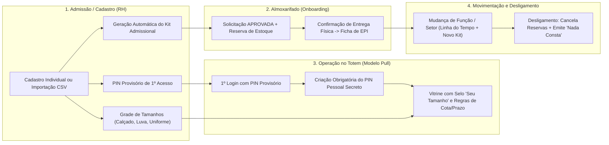

# Documentação Técnica e Funcional: Ciclo de Vida de RH, Onboarding de EPIs e Governança Operacional

**Projeto:** SupplyFlow — Sistema Web de Gestão, Autoatendimento (*Pull*) e Apoio à Decisão para Fornecimento de EPIs e Consumíveis  
**Módulos Abrangidos:** Gestão de Funcionários (RH), Autoatendimento no Totem, Motor de Elegibilidade, Almoxarifado (Entregas/Reservas) e Ficha Eletrônica de EPI (NR-06)  
**Requisitos Relacionados:** `RF-01`, `RF-04`, `RF-07`, `RF-10`, `RF-11`, `RF-12`, `RF-15` a `RF-20`, `RF-35`, `RF-39`, `RF-43`, `RF-46`, `RF-50`, `RNF-03`, `RNF-05` (LGPD), `RNF-07`, `RNF-10`, `RNF-11` e `RNF-18`

---

## 1. Visão Geral do Ciclo de Vida do Colaborador (RH ↔ SST ↔ Almoxarifado)

Para eliminar falhas de comunicação entre o **Recursos Humanos (RH)**, a **Segurança do Trabalho (SST)** e o **Almoxarifado**, o SupplyFlow implementa o ciclo de vida completo do colaborador operacional em 6 pilares integrados:

1. **Troca Obrigatória de PIN Provisório no 1º Acesso ao Totem** (Não-repúdio e LGPD);
2. **Perfil Antropométrico / Grade de Tamanhos do Funcionário** (`Calçado`, `Luva`, `Vestimenta`);
3. **Geração Automática do Kit Admissional de EPIs** (Integração imediata RH → Fila de Entregas do Almoxarife);
4. **Fluxo de Mudança de Função / Transferência de Setor** (Rastreabilidade funcional na Ficha de EPI + Kit da nova função);
5. **Checklist de Desligamento (*Offboarding*) e Termo "Nada Consta"** (Cancelamento automático de reservas e verificação de devoluções pendentes);
6. **Importação em Lote de Funcionários via Planilha CSV** (Admissão rápida de turmas operacionais).



---

## 2. Detalhamento das 6 Funcionalidades Implementadas

### 2.1. PIN Provisório e Troca Obrigatória no 1º Acesso ao Totem (`RF-11`, `RNF-03`, `RNF-05`)
- **Problema resolvido:** Quando o RH define o PIN inicial do colaborador, esse código é temporariamente conhecido por quem realizou o cadastro. Para garantir **não-repúdio jurídico** nas solicitações registradas na Ficha Eletrônica de EPI (NR-06), apenas o próprio trabalhador deve conhecer seu PIN definitivo.
- **Funcionamento:**
  1. Ao cadastrar ou redefinir o PIN de um funcionário em [`backoffice/funcionarios.html`](file:///c:/Users/Usuario/Documents/GitHub/SupplyFlow/backoffice/funcionarios.html) (ou via importação CSV), o campo `#func-exigir-troca-pin` marca o registro com `pin_provisorio = True` (cadastros antigos já em operação permanecem com `pin_provisorio = False`).
  2. Quando o colaborador digita sua matrícula e o PIN provisório em [`POST /api/totem/login/`](file:///c:/Users/Usuario/Documents/GitHub/SupplyFlow/core/views/totem.py#L110-L155), o servidor retorna `"exige_troca_pin": true`.
  3. O Totem ([`totem/index.html`](file:///c:/Users/Usuario/Documents/GitHub/SupplyFlow/totem/index.html) / [`static/js/totem.js`](file:///c:/Users/Usuario/Documents/GitHub/SupplyFlow/static/js/totem.js)) bloqueia o avanço direto à vitrine e exibe a tela `#passo-trocar-pin`, solicitando que o trabalhador digite e confirme seu novo PIN pessoal de 4 dígitos.
  4. O endpoint [`POST /api/totem/trocar-pin/`](file:///c:/Users/Usuario/Documents/GitHub/SupplyFlow/core/views/totem.py#L158-L187) valida que o novo PIN não é trivial (`1234`, `0000`, dígitos repetidos) e que **é diferente do PIN provisório**, grava o novo hash `PBKDF2-SHA256`, desativa a flag `pin_provisorio` e registra o evento `TOTEM_PIN_ALTERADO` na auditoria.

### 2.2. Grade de Tamanhos do Funcionário / Perfil Antropométrico (`RF-07`, `RF-15`, `RF-19`, `RNF-11`)
- **Problema resolvido:** Evita que o colaborador solicite por engano um EPI de numeração incompatível no totem ou que o almoxarife precise adivinhar o tamanho na separação do Kit Admissional.
- **Funcionamento:**
  1. O cadastro do funcionário registra três medidas: **Calçado** (ex.: `41`), **Luva** (ex.: `M`) e **Vestimenta / Uniforme** (ex.: `G`).
  2. No serviço [`tamanho_esperado_para_produto`](file:///c:/Users/Usuario/Documents/GitHub/SupplyFlow/core/servicos/rh.py#L181-L199) e em [`avaliar`](file:///c:/Users/Usuario/Documents/GitHub/SupplyFlow/core/servicos/elegibilidade.py#L120-L162), o servidor cruza o `produto.tamanho` com a medida correspondente do colaborador:
     - **Tamanho compatível:** recebe `tamanho_recomendado = True` e exibe o selo verde **`Seu tamanho`** no card do Totem.
     - **Tamanho divergente:** continua visível na vitrine do Totem, mas é classificado como solicitação excepcional com motivo `TAMANHO_DIFERENTE` (**`"Tamanho inadequado"`**), exigindo justificativa textual para análise do gestor/técnico de segurança.

### 2.3. Geração Automática do Kit Admissional de EPIs (`RF-12`, `RF-18`, `RF-39`, `RF-41`)
- **Problema resolvido:** Conecta imediatamente a admissão no RH à fila de separação física do Almoxarifado, sem exigir que o colaborador recém-contratado peça item por item no primeiro dia.
- **Funcionamento:**
  1. Com a opção **"Gerar automaticamente o Kit Admissional de EPIs"** (`#func-gerar-kit`) marcada no cadastro do colaborador, a função [`gerar_kit_admissional`](file:///c:/Users/Usuario/Documents/GitHub/SupplyFlow/core/servicos/rh.py#L213-L338) seleciona todos os EPIs ativos vinculados ao Cargo/Setor do funcionário e compatíveis com sua grade de tamanhos.
  2. Cria automaticamente as solicitações já com status **`APROVADA`**, vinculadas à decisão formal de admissão e com **reserva imediata de saldo no `EstoqueTotem`** (`RF-39`).
  3. Os itens aparecem instantaneamente em [`backoffice/entregas.html`](file:///c:/Users/Usuario/Documents/GitHub/SupplyFlow/backoffice/entregas.html) prontos para conferência e entrega física pelo almoxarife.

### 2.4. Mudança de Função / Transferência de Setor (`RF-04`, `RF-43`, `RNF-18`)
- **Problema resolvido:** Preserva a memória organizacional na Ficha de EPI quando um colaborador é promovido ou transferido de setor/centro de custo, além de provisionar os EPIs da nova função.
- **Funcionamento:**
  1. Na tabela de [`backoffice/funcionarios.html`](file:///c:/Users/Usuario/Documents/GitHub/SupplyFlow/backoffice/funcionarios.html), o botão **Mudar Função / Setor** abre o modal `#modal-mudar-funcao`.
  2. O endpoint [`POST /api/funcionarios/<uuid>/mudar-funcao/`](file:///c:/Users/Usuario/Documents/GitHub/SupplyFlow/core/views/cadastros.py#L205-L270) atualiza o Cargo e o Setor/Centro de Custo, grava o evento `MUDANCA_FUNCAO` (com cargo anterior, cargo novo, setor anterior, setor novo, data, responsável e observação) e, se selecionado pelo RH, gera automaticamente o **Kit de Mudança de Função**.
  3. Toda a trajetória do colaborador é exibida na seção **Histórico Funcional** dentro de [`backoffice/ficha-epi.html`](file:///c:/Users/Usuario/Documents/GitHub/SupplyFlow/backoffice/ficha-epi.html).

### 2.5. Checklist de Desligamento (*Offboarding*) e Termo "Nada Consta" (`RF-01`, `RF-31`, `RF-50`)
- **Problema resolvido:** Impede que solicitações aprovadas e não retiradas continuem travando estoque após a saída de um funcionário e fornece visibilidade sobre EPIs em posse no processo demissional.
- **Funcionamento:**
  1. Ao clicar em **Inativar / Desligar** em um funcionário ativo, o frontend consulta [`GET /api/funcionarios/<uuid>/desligamento/`](file:///c:/Users/Usuario/Documents/GitHub/SupplyFlow/core/views/cadastros.py#L273-L281) e abre o modal `#modal-desligamento` exibindo:
     - Quantidade de solicitações/reservas abertas que serão canceladas automaticamente;
     - Lista dos últimos EPIs entregues em posse do colaborador (`epis_em_posse`);
     - Alerta caso existam devoluções condicionadas pendentes (`devolucoes_pendentes`);
     - Atalho direto para emitir e imprimir o **Termo de Nada Consta de EPI** (`ficha-epi.html?id=<uuid>&nada_consta=1`).
  2. Ao confirmar a inativação em [`POST /api/funcionarios/<uuid>/toggle/`](file:///c:/Users/Usuario/Documents/GitHub/SupplyFlow/core/views/cadastros.py#L284-L329), o servidor inativa o acesso ao totem/backoffice, cancela todas as solicitações abertas/aprovadas liberando as reservas de estoque (`servico_solicitacoes.cancelar`) e grava o registro de `DESLIGAMENTO` na ficha funcional.

### 2.6. Importação em Lote de Funcionários via CSV (`RF-01`, `RF-04`)
- **Problema resolvido:** Permite ao RH cadastrar ou atualizar dezenas de colaboradores admitidos em uma mesma turma em segundos.
- **Funcionamento:**
  1. O modal `#modal-importar-csv` aceita upload de arquivo `.csv`/`.txt` ou colagem direta de texto no padrão:
     ```csv
     matricula;nome;cargo;setor;pin_inicial;calcado;luva;vestimenta;funcao;habilitacoes
     MAT-3001;Carlos Eduardo;Soldador;Produção Industrial;8392;41;M;G;Soldagem MIG;NR-35 Trabalho em Altura:2027-12-31|Brigadista
     ```
  2. O endpoint [`POST /api/funcionarios/importar-csv/`](file:///c:/Users/Usuario/Documents/GitHub/SupplyFlow/core/views/cadastros.py) atualiza colaboradores já existentes pela matrícula e cria os novos, associando ou criando o setor correspondente, configurando a grade de tamanhos, função operacional, habilitações/NRs, marcando o PIN provisório e gerando opcionalmente o Kit Admissional.

### 2.7. Arquitetura de 3 Categorias Ocupacionais: Cargo (RH) vs. Função (SST) vs. Habilitações & Credenciais de Risco (NRs com Validade) (`RF-03`, `RF-04`, `RF-12`, `RF-15`, `RF-19`)
- **Problema resolvido:** Em ambientes industriais reais (eSocial, NR-01/PGR e NR-06), o **Cargo contratual** (folha de pagamento) não é suficiente para definir todos os EPIs de um trabalhador. Dois colaboradores com o mesmo cargo (`Eletricista Industrial`) podem exercer **Funções** distintas (`Manutenção de Painéis` vs. `Subestação`) e possuir **Habilitações/Credenciais de Risco (NRs)** com validade controlada (`NR-35 Trabalho em Altura`, `NR-10 Alta Tensão`, `NR-33 Espaço Confinado`, `Brigadista`).
- **Funcionamento em 3 Camadas:**
  1. **1ª Categoria — Cargo (RH — `RF-03`):** Posição contratual armazenada em `Usuario.cargo` e gerenciada na 1ª aba de [`backoffice/cargos.html`](file:///c:/Users/Usuario/Documents/GitHub/SupplyFlow/backoffice/cargos.html).
  2. **2ª Categoria — Função / Atividade Operacional (SST — `RF-04`):** Atividade prática executada no chão de fábrica (`ficha_rh["funcao"]`), gerenciada na 2ª aba de [`backoffice/cargos.html`](file:///c:/Users/Usuario/Documents/GitHub/SupplyFlow/backoffice/cargos.html) (`/api/funcoes/salvar/`, `/api/funcoes/excluir/`).
  3. **3ª Categoria — Habilitações & Credenciais de Risco (NRs / Licenças com Validade):** Múltiplas etiquetas por colaborador (`ficha_rh["habilitacoes"]`), cada uma com sua própria **Data de Validade** opcional (`YYYY-MM-DD`), gerenciadas na 3ª aba de [`backoffice/cargos.html`](file:///c:/Users/Usuario/Documents/GitHub/SupplyFlow/backoffice/cargos.html) (`/api/habilitacoes/salvar/`, `/api/habilitacoes/excluir/`).
- **Motor de Elegibilidade e Controle de Vencimento no Totem ([`core/servicos/elegibilidade.py`](file:///c:/Users/Usuario/Documents/GitHub/SupplyFlow/core/servicos/elegibilidade.py)):**
  - As Políticas de Fornecimento ([`backoffice/politicas.html`](file:///c:/Users/Usuario/Documents/GitHub/SupplyFlow/backoffice/politicas.html)) permitem vincular regras a **Cargo**, **Função (`FUNC:`)** ou **Habilitação/NR (`HAB:`)**, seguindo a hierarquia de especificidade:
    $$\text{Funcionário} > \text{Habilitação/NR} > \text{Função} > \text{Cargo} > \text{Setor} > \text{Padrão do Produto}$$
  - **Exceção por Habilitação Vencida (`HABILITACAO_VENCIDA`):** Se o colaborador tentar retirar no Totem um EPI vinculado a uma Habilitação/NR cuja data de validade esteja vencida na sua ficha, o servidor classifica automaticamente o pedido como **Solicitação por Exceção (`"Habilitação/credencial vencida"`)**, exigindo justificativa e aprovação do Gestor/SST antes da liberação!
  - **Kit Admissional Composto:** Ao admitir ou promover o colaborador, o Kit Admissional soma automaticamente os EPIs do seu **Cargo** + **Função** + **Habilitações vigentes**.

---

## 3. Decisão Arquitetural de Persistência (Zero-Migration no PostgreSQL / Render)

Para garantir compatibilidade imediata com o banco de dados PostgreSQL em produção no Render sem risco de falha em migrações de schema (`ALTER TABLE`):

- Os metadados estendidos de RH (`tamanhos`, `pin_provisorio` e `historico_funcional`) são persistidos na tabela existente `auditoria` ([`RegistroAuditoria`](file:///c:/Users/Usuario/Documents/GitHub/SupplyFlow/core/models.py#L317-L339)) utilizando o namespace dedicado `entidade="RH_FUNCIONARIO"` e `entidade_id=str(usuario.id)`, com payload estruturado no campo `detalhes` (`JSONField`).
- Essa abordagem oferece **duplo benefício arquitetural**:
  1. **Imutabilidade e Rastreabilidade (`RNF-07`, `RNF-18`):** Cada alteração de tamanho, redefinição de PIN provisório, admissão, mudança de função ou desligamento é naturalmente um evento auditado com data, hora, IP e responsável.
  2. **Deploy Zero-Downtime:** Nenhuma tabela existente precisou sofrer alteração estrutural destrutiva.

---

## 4. Contratos de API Adicionados / Evoluídos

| Método e Rota | Permissão | Descrição |
| :--- | :---: | :--- |
| `POST /api/totem/trocar-pin/` | `@api_totem` | Valida e grava o novo PIN pessoal definitivo do colaborador no 1º acesso ao Totem. |
| `POST /api/funcionarios/<uuid>/mudar-funcao/` | `@api_backoffice("pessoas")` | Atualiza cargo e setor do colaborador, registra transição na Ficha de EPI e gera opcionalmente o kit da nova função. |
| `GET /api/funcionarios/<uuid>/desligamento/` | `@api_backoffice("pessoas")` | Retorna o checklist de desligamento (EPIs em posse, devoluções pendentes, solicitações abertas e aptidão para Nada Consta). |
| `POST /api/funcionarios/importar-csv/` | `@api_backoffice("pessoas")` | Importa ou atualiza funcionários em lote via CSV com tamanhos, PIN provisório e Kit Admissional opcional. |
| `GET /api/funcionarios/<uuid>/ficha/` | `@api_backoffice("ver")` | Evoluído para incluir `funcionario.tamanhos`, `historico_funcional` e `nada_consta`. |

---

## 5. Rastreabilidade de Arquivos e Testes

- **Serviço de Domínio de RH:** [`core/servicos/rh.py`](file:///c:/Users/Usuario/Documents/GitHub/SupplyFlow/core/servicos/rh.py)
- **Motor de Elegibilidade (Tamanhos):** [`core/servicos/elegibilidade.py`](file:///c:/Users/Usuario/Documents/GitHub/SupplyFlow/core/servicos/elegibilidade.py)
- **Views de Cadastro e RH:** [`core/views/cadastros.py`](file:///c:/Users/Usuario/Documents/GitHub/SupplyFlow/core/views/cadastros.py)
- **Views da Ficha Eletrônica de EPI:** [`core/views/relatorios.py`](file:///c:/Users/Usuario/Documents/GitHub/SupplyFlow/core/views/relatorios.py)
- **Views do Totem (Troca de PIN e Tamanhos):** [`core/views/totem.py`](file:///c:/Users/Usuario/Documents/GitHub/SupplyFlow/core/views/totem.py)
- **Interfaces e Scripts Frontend:**
  - [`backoffice/funcionarios.html`](file:///c:/Users/Usuario/Documents/GitHub/SupplyFlow/backoffice/funcionarios.html) e [`static/js/funcionarios.js`](file:///c:/Users/Usuario/Documents/GitHub/SupplyFlow/static/js/funcionarios.js)
  - [`backoffice/ficha-epi.html`](file:///c:/Users/Usuario/Documents/GitHub/SupplyFlow/backoffice/ficha-epi.html) e [`static/js/ficha-epi.js`](file:///c:/Users/Usuario/Documents/GitHub/SupplyFlow/static/js/ficha-epi.js)
  - [`totem/index.html`](file:///c:/Users/Usuario/Documents/GitHub/SupplyFlow/totem/index.html) e [`static/js/totem.js`](file:///c:/Users/Usuario/Documents/GitHub/SupplyFlow/static/js/totem.js)
- **Testes Unitários Automatizados:** [`core/tests/test_regras.py`](file:///c:/Users/Usuario/Documents/GitHub/SupplyFlow/core/tests/test_regras.py#L317-L442)
