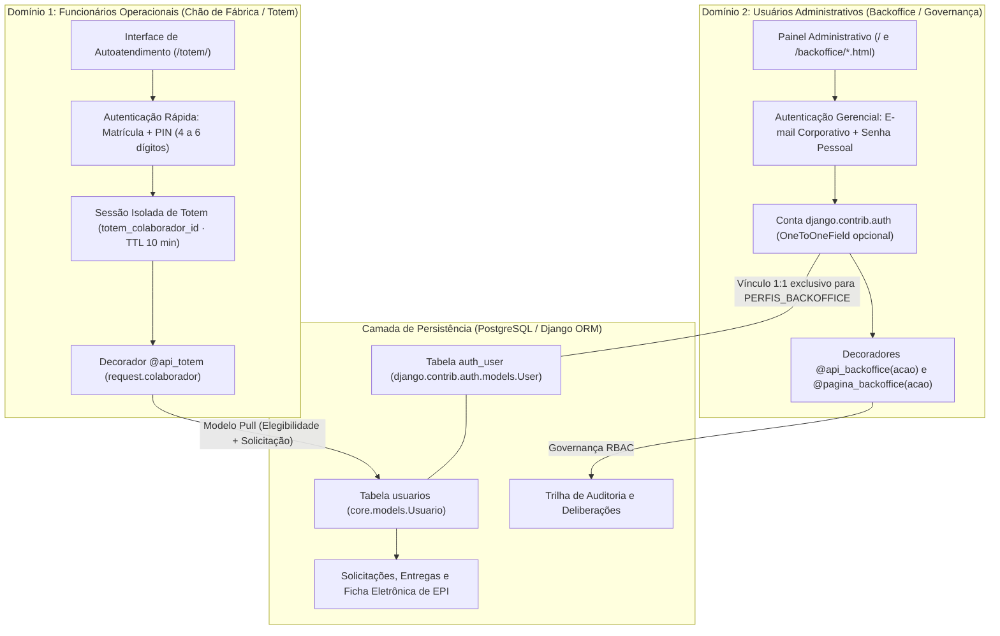

# Decisão Arquitetural (ADR): Separação de Domínios entre Funcionários Operacionais (Totem) e Usuários Administrativos (Backoffice / RBAC)

**Projeto:** SupplyFlow — Sistema Web de Gestão, Autoatendimento (*Pull*) e Apoio à Decisão para Fornecimento de EPIs e Consumíveis  
**Requisitos Relacionados:** `RF-01`, `RF-08`, `RF-09`, `RF-10`, `RF-11`, `RNF-03`, `RNF-04`, `RNF-05` (LGPD), `RNF-10` e `RNF-12`

---

## 1. Contexto e Problema Arquitetural

Em ambientes industriais e logísticos, coexistem dois perfis de atores com necessidades operacionais, ergonômicas e de segurança radicalmente distintas:

1. **Trabalhadores Operacionais (Chão de Fábrica):**
   - Atuam diretamente na produção, manutenção ou operação logística, frequentemente utilizando luvas ou equipamentos de proteção e compartilhando terminais físicos (totens *touchscreen* ou leitores de crachá/RFID).
   - Na realidade industrial brasileira, a grande maioria dos operadores de chão de fábrica **não possui endereço de e-mail corporativo individual** nem utiliza estações de trabalho administrativas.
   - Precisam de um fluxo de autoatendimento rápido (modelo *pull* — menos de 15 segundos por retirada), alimentando automaticamente sua **Ficha Eletrônica de EPI (`RF-43`)** e respeitando as **Políticas de Fornecimento (`RF-12` a `RF-15`)**.

2. **Operadores de Gestão e Governança (Backoffice Administrativo):**
   - Compreendem **Almoxarifes (`OPERADOR`)**, **Técnicos de Segurança do Trabalho (`TECNICO_SEGURANCA`)**, **Compradores (`COMPRADOR`)**, **Gestores/Supervisores (`GESTOR`)** e **Administradores (`ADMIN`)**.
   - Executam tarefas críticas de governança: deliberação de solicitações excepcionais com apoio de IA (`RF-22` a `RF-29`), confirmação de entregas físicas e devoluções (`RF-31` a `RF-42`), gestão de lotes/estoque e auditoria (`RF-46`).
   - Exigem autenticação forte individualizada por e-mail corporativo e senha alfanumérica pessoal, além de **Controle de Acesso Baseado em Papéis (`RBAC` — `RF-09`, `RNF-04`)** validado no servidor.

Misturar esses dois públicos em um único fluxo de credenciais violaria tanto a **usabilidade no totem (`RNF-10`)** (exigir e-mail e senha complexa no chão de fábrica inviabiliza o autoatendimento) quanto a **segurança e a LGPD (`RNF-03`, `RNF-05`)** (conceder contas de login administrativo a quem opera apenas no terminal físico aumentaria a superfície de ataque).

---

## 2. Arquitetura da Solução: Isolamento em Dois Domínios

O SupplyFlow implementa uma separação estrita de domínios sobre uma base relacional íntegra, isolando **credenciais**, **sessões HTTP**, **rotas de API**, **decoradores de autorização** e **interfaces de usuário**:

---

## 3. Comparativo Técnico entre os Domínios

| Dimensão Arquitetural | Domínio 1: Funcionários Operacionais (Totem) | Domínio 2: Usuários Administrativos (Backoffice) |
| :--- | :--- | :--- |
| **Público-Alvo** | Trabalhadores da linha de frente (`perfil = "COLABORADOR"`). | Almoxarife, Técnico de Segurança, Comprador, Gestor e Administrador (`PERFIS_BACKOFFICE`). |
| **Propriedade no Model (`Usuario`)** | `usuario.eh_operacional == True` | `usuario.eh_administrativo == True` |
| **Atributos Obrigatórios** | `nome`, `codigo_matricula`, `cargo` (Função), `setor` (Centro de Custo) e `pin_hash`. | `nome`, `email` corporativo, `perfil` RBAC e vínculo `conta` (`auth_user`). |
| **E-mail Corporativo** | **Dispensado** (minimização de dados — `RNF-05`). | **Obrigatório** (usado para login e envio do link tokenizado de criação de senha). |
| **Credencial de Autenticação** | **PIN numérico (4 a 6 dígitos)** com bloqueio de sequências triviais (`1234`, `0000`, etc.) e hash `PBKDF2-SHA256`. | **Senha alfanumérica pessoal** criada pelo próprio titular via link de uso único (o administrador nunca vê nem define senhas). |
| **Vínculo com `auth_user`** | **Inexistente (`conta = None`)** ou desativado (`is_active = False`). | **Ativo (`OneToOneField`)** gerenciado automaticamente por `garantir_conta()` em `core/contas.py`. |
| **Mecanismo de Sessão** | Chaves isoladas `request.session["totem_colaborador_id"]` e `totem_expira_em` (expiração automática após 10 min de inatividade). | Sessão autenticada do Django (`django.contrib.auth.login`) validada a cada requisição por `usuario_da_requisicao()`. |
| **Proteção contra Força Bruta** | Bloqueio temporário por matrícula (`bloqueado("pin", matricula)`) após 5 falhas em 15 minutos. | Bloqueio temporário por e-mail (`bloqueado("login", email)`) após 5 falhas em 15 minutos. |
| **Decorador de Proteção** | `@api_totem` (`core/views/totem.py`) — popula `request.colaborador`. | `@api_backoffice("<acao>")` e `@pagina_backoffice("<acao>")` (`core/permissoes.py`) — popula `request.usuario`. |
| **Telas e Endpoints de Gestão** | `backoffice/funcionarios.html` (`GET /api/funcionarios/`, `POST /api/funcionarios/salvar/`). | `backoffice/usuarios.html` (`GET /api/usuarios/`, `POST /api/usuarios/salvar/`, `POST /api/funcionarios/<id>/enviar-link-senha/`). |

---

## 4. Isolamento de Segurança e Conformidade com a LGPD (`RNF-03`, `RNF-04`, `RNF-05`)

### 4.1. Incomunicabilidade de Sessões (Barreira Bidirecional)
1. **Totem → Backoffice (Bloqueado):**
   - Quando um colaborador se autentica em `POST /api/totem/login/`, o servidor grava apenas `totem_colaborador_id` na sessão e **não** invoca `django.contrib.auth.login()`. Portanto, `request.user` permanece `AnonymousUser`. Qualquer tentativa de acessar rotas protegidas por `@api_backoffice` ou `@pagina_backoffice` é imediatamente recusada com `HTTP 401`.
   - Mesmo que um colaborador possua um e-mail cadastrado e tente usá-lo em `POST /api/login/`, a consulta filtra explicitamente `perfil__in=PERFIS_BACKOFFICE` (`core/views/autenticacao.py#L53`), barrando o login administrativo (validado pelo teste `test_colaborador_nao_entra_no_backoffice`).
2. **Backoffice → Totem (Isolado):**
   - Estar autenticado no painel administrativo (`request.user`) não abre sessão no totem (`totem_colaborador_id`). As rotas `@api_totem` exigem validação explícita de Matrícula + PIN no terminal de autoatendimento e ignoram qualquer matrícula enviada no corpo das requisições subsequentes, prevenindo falsificação de identidade (*IDOR*).

### 4.2. Conformidade com a LGPD (`RNF-05`)
- **Princípio da Necessidade (Minimização de Dados):** Trabalhadores operacionais do chão de fábrica não precisam fornecer e-mail pessoal ou corporativo para retirar seus EPIs. Apenas os dados estritamente necessários para a rastreabilidade trabalhista (NR-06) e alocação contábil (Nome, Matrícula, Cargo/Função e Setor/Centro de Custo) são coletados.
- **Prevenção à Exposição Pré-Autenticação no Totem:** Na etapa 1 do totem (`POST /api/totem/identificar/`), antes da digitação do PIN, a API retorna **exclusivamente o primeiro nome** do colaborador (`primeiro_nome`), omitindo sobrenome, cargo, setor, centro de custo e histórico de retiradas até que o PIN seja validado (`POST /api/totem/login/`).
- **Sigilo Absoluto de Credenciais Administrativas:** No Domínio 2, nenhum administrador define ou visualiza a senha de outro usuário. Ao cadastrar um usuário administrativo em `POST /api/usuarios/salvar/`, a conta `auth_user` é criada com `set_unusable_password()` e o sistema dispara um token criptográfico assinado com validade de 1 hora (`/senha/nova/<uidb64>/<token>/`) para que o próprio titular defina sua senha.

---

## 5. Decisão de Modelagem Relacional sem Migrações Destrutivas

Para preservar a integridade referencial no PostgreSQL em produção (Render) e manter consultas de alta performance nos relatórios e na ficha eletrônica de EPI:

- A tabela `usuarios` (`core.models.Usuario`) centraliza o cadastro funcional (chave estrangeira de `Solicitacao.solicitante`, `Entrega.colaborador`, `Entrega.almoxarife`, `DecisaoSolicitacao.aprovador` e `RegistroAuditoria.usuario`).
- O vínculo com a tabela de autenticação `auth_user` (`Usuario.conta`) é uma relação `OneToOneField(..., null=True, blank=True, on_delete=models.SET_NULL)` gerenciada de forma determinística pela função `garantir_conta(usuario)` em `core/contas.py`:
  - Se `usuario.eh_operacional` (`perfil == "COLABORADOR"`), nenhuma conta `auth_user` é criada (e caso o usuário tenha sido rebaixado de um perfil administrativo para colaborador, sua conta `auth_user` é imediatamente desativada com `conta.is_active = False`).
  - Se `usuario.eh_administrativo` (`perfil in PERFIS_BACKOFFICE`), a conta `auth_user` é criada/sincronizada e vinculada.

---

## 6. Rastreabilidade no Código-Fonte

| Componente | Caminho no Repositório | Responsabilidade na Separação de Domínios |
| :--- | :--- | :--- |
| **Model de Domínio** | `core/models.py` (`Usuario`) | Define `PERFIS_ADMINISTRATIVOS` e as propriedades `eh_operacional`, `eh_administrativo`, `possui_pin_totem` e `possui_acesso_backoffice`. |
| **Matriz RBAC e Decoradores** | `core/permissoes.py` | Define `PERFIS`, `ACOES`, `PERFIS_BACKOFFICE`, `usuario_da_requisicao`, `@api_backoffice` e `@pagina_backoffice`. |
| **Ciclo de Vida de Contas** | `core/contas.py` | Sincroniza ou desativa a conta `auth_user` (`garantir_conta`) e envia o link de criação de senha (`enviar_link_de_senha`). |
| **Criptografia de PIN e Senhas** | `core/seguranca.py` | Valida e gera hash `PBKDF2-SHA256` para o PIN do totem (`definir_pin`, `verificar_pin`), controla bloqueio de força bruta e impede reutilização da senha atual (`SenhaDiferenteDaAtual`). |
| **APIs do Totem (Domínio 1)** | `core/views/totem.py` | Implementa `@api_totem`, `api_totem_identificar` e `api_totem_login` exclusivamente por Matrícula + PIN. |
| **APIs de Gestão (Domínio 1 e 2)** | `core/views/cadastros.py` e `core/views/solicitacoes.py` | `api_listar_funcionarios` (com filtro `?dominio=operacional\|administrativo`), `api_salvar_funcionario` (Domínio 1) e `api_listar_usuarios` / `api_salvar_usuario_backoffice` (Domínio 2). |
| **Interfaces Web** | `backoffice/funcionarios.html` (`static/js/funcionarios.js`) e `backoffice/usuarios.html` (`static/js/usuarios.js`) | Separam visual e funcionalmente o cadastro operacional de chão de fábrica da governança de usuários administrativos e permissões RBAC. |
| **Testes Automatizados** | `core/tests/test_autenticacao.py` | Valida o isolamento entre colaborador e backoffice, obrigatoriedade de PIN no domínio operacional, criação de usuário administrativo sem PIN e proteção RBAC (`401`/`403`). |

